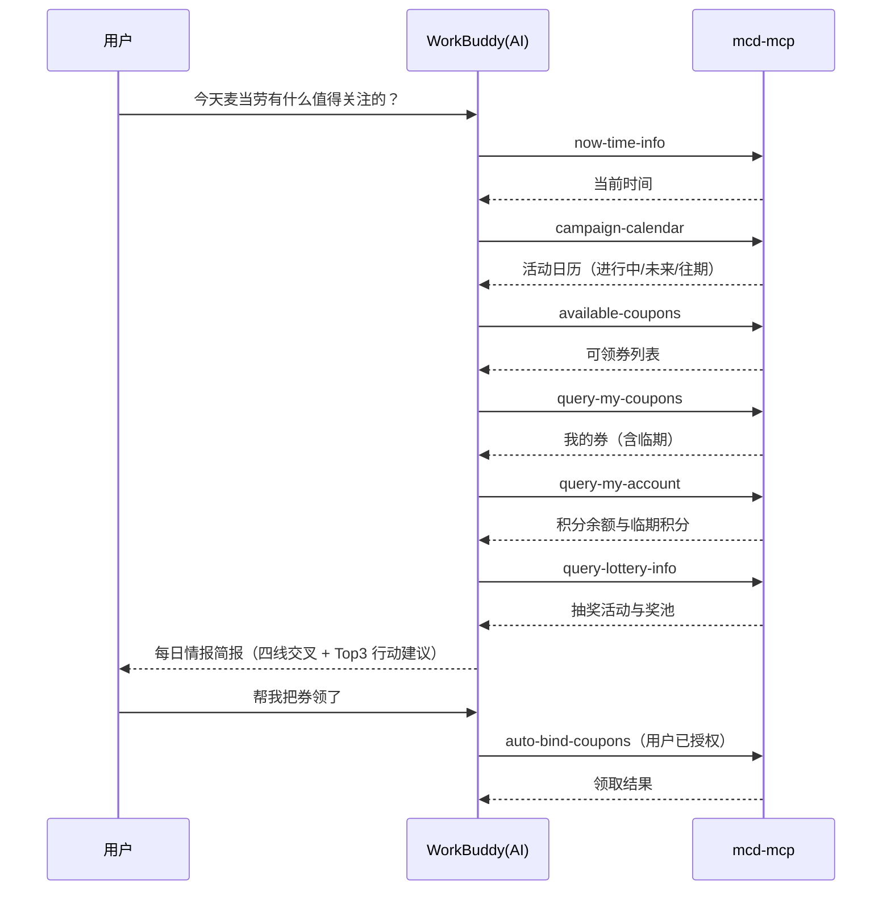

# 麦当劳 MCP 接入说明（MCP_INTEGRATION）

本项目**真实使用**麦当劳中国官方 MCP Server 提供的能力，所有活动、券、积分、抽奖、预约查询均通过该 MCP 完成。

## 1. 接入的 MCP Server

| 项 | 值 |
|---|---|
| 提供方 | 麦当劳中国（M-China，官方 GitHub 组织） |
| Server 地址 | `https://mcp.mcd.cn` |
| 传输协议 | Streamable HTTP |
| 鉴权 | 请求头 `Authorization: Bearer <MCP Token>` |
| Token 获取 | <https://open.mcd.cn/mcp> 登录后「控制台 → 激活」复制 |
| 限流 | 每 Token 600 次/分钟（超限返回 429，需降频） |
| 官方指南 | <https://github.com/M-China/mcd-mcp-server> |

> Token **不入库、不写日志、不回显**；本仓库仅以环境变量占位符 `${MCD_MCP_TOKEN}` 出现（见 `mcp-config.example.json`）。

## 2. 实际使用的工具（Tool）

| Tool | 用途 | 在流程中的阶段 |
|---|---|---|
| `now-time-info` | 校准当前时间 | 时间基准（每次会话第一步） |
| `campaign-calendar` | 当月营销活动日历 | 情报主线 |
| `available-coupons` | 可领「麦麦省」券 | 优惠情报 |
| `auto-bind-coupons` | 一键领券 | 深入操作（授权后） |
| `query-my-coupons` | 我的券 / 临期券筛选 | 优惠情报 |
| `query-store-coupons` | 指定门店可用券 | 优惠情报（扩展） |
| `query-my-account` | 积分余额与临期积分 | 账户情报 |
| `query-lottery-info` | 抽奖活动状态与奖池 | 抽奖情报 |
| `draw-lottery` | 执行抽奖 | 深入操作（授权后） |
| `query-my-prizes` | 中奖记录 | 抽奖后核对 |
| `mall-points-products` / `mall-product-detail` | 商城商品列表/详情 | 积分兑换比选 |
| `mall-create-order` | 积分兑换下单 | 深入操作（授权后） |
| `mall-order-list` / `mall-order-detail` | 商城订单查询 | 兑换后核对 |
| `query-party-city` / `query-party-store` / `query-party-store-date` / `query-party-store-session` | 主题活动城市→门店→日期→场次 | 派对预约链路 |
| `party-order-create` | 主题活动下单 | 深入操作（授权后） |
| `query-meals` / `query-meal-detail` | 菜单与套餐详情 | 活动餐品联动 |
| `list-nutrition-foods` | 营养成分参考 | 新品联动 |
| `query-nearby-stores` | 附近门店 | 位置联动 |

## 3. 调用流程

## 4. 业务价值

- **信息聚合**：活动、券、积分、抽奖、派对分散在麦当劳 App 的多个入口，本 Skill 一次会话拉齐，输出统一简报。
- **临期止损**：即将过期的券和积分是最容易浪费的资产，Skill 自动识别并给出行动建议。
- **交叉决策**：不只罗列信息，而是做券×活动、积分×抽奖×商城的交叉分析，给出可执行的 Top 3 建议。
- **安全闭环**：所有写操作（领券/抽奖/兑换/预约）默认不执行，用户显式授权后才调用。

## 5. 合规

- 严格遵循《麦当劳 MCP 服务规则》：非商业用途、Token 妥善保管、不超频（600 次/分钟以内）。
- 写操作属敏感操作，Skill 内强制「用户显式授权」才调用，不做静默操作。
- 项目非麦当劳官方产品，输出以官方实时结果为准。
